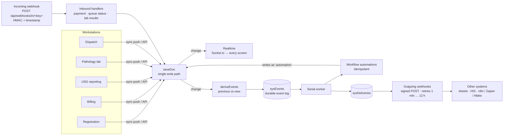

# Event-driven automation & webhooks

The clinic server turns every saved change into **domain events**. Built-in **workflow automations**
react to those events and move the patient along (queue status, bill links, visit close), and
**webhooks** carry events to other systems and let them send payments, queue updates and analyzer
results back. It all runs on the server, so it keeps working when every workstation screen is closed.

Settings → **Automation** shows the automations (on / off and what they did), the live event stream,
outgoing webhook endpoints with their delivery log, and the incoming webhook.

## Architecture



* **One write path.** Every document — from a workstation, an API call, an inbound webhook or an
  automation — is saved through `ctx.saveDoc()`, which broadcasts it to every screen and emits a
  `change` on the server's event bus.
* **Event derivation** (`server/services/automation/derive.js`) compares the previous and the new
  version and names what happened: `invoice.paid`, `report.signed`, `lab.sample_collected` …
* **Durable log.** Each event is stored in the server-only collection `sysEvents` *before* it is
  processed (status `pending`). Events still pending after a restart are processed on start-up
  (at-least-once). Workstations never receive this collection.
* **Serial worker.** Events are processed one after another in arrival order, so two automations never
  write the same record at the same moment.
* **Idempotent automations.** Each automation reads the *current* record and writes only when something
  must change ("already linked", "already completed" otherwise). Running an event twice changes nothing
  the second time, which makes replays and retries safe. Their writes carry the actor `automation`, and
  those writes produce their own events (that is how `visit.completed` follows the last test).
* **Deliveries** are stored in `sysDeliveries` and retried after 1 min, 5 min, 30 min, 2 h, 6 h and
  12 h (7 tries in about 21 hours), then marked `dead`. An endpoint that answers `410 Gone`, or fails
  10 deliveries in a row after every retry, is switched off and every workstation is told.
* Events and deliveries are kept for **30 days**.

Code: `shared/events.js` (catalogue, shared by server and browser) ·
`server/services/automation/derive.js` · `server/services/automation/engine.js` ·
`server/routes/automation.routes.js` · `client/src/modules/settings/AutomationTab.jsx`.

## Events

| Area | Event | When |
|---|---|---|
| Registration & queue | `patient.registered` | a new patient record |
| | `patient.updated` | name, mobile, address, age, gender or guardian changed |
| | `patient.deleted`, `patient.restored`, `patient.purged` | an administrator moved the patient (with every linked record) to the recycle bin, restored it, or deleted it permanently — one event per patient; restoring does not repeat the original registration, bill or payment events |
| | `visit.created` | a visit is registered and tokens issued |
| | `queue.called` | a token is called to a room |
| | `queue.status_changed` | Waiting → In Scan/Sample → Completed, per department |
| | `visit.completed` | every test Completed and every bill paid (set by the automation) |
| | `visit.cancelled`, `visit.restored` | an entry was cancelled because the patient did not go ahead with the tests (or the cancellation was undone) |
| Billing | `invoice.created`, `invoice.updated` | a bill is saved / its amount or items change |
| | `payment.received` | each new payment (desk, cash book, dues ledger or webhook) |
| | `invoice.paid` | the balance reaches zero |
| | `invoice.cancelled`, `invoice.restored` | the bill was cancelled with its entry (or restored) |
| Clinical reporting | `report.started`, `report.signed`, `report.unlocked` | USG / X-ray / ECG / Echo reports |
| | `formf.finalized` | PC-PNDT Form F marked final |
| Pathology lab | `lab.sample_collected`, `lab.results_entered`, `lab.verified` | sample → technician → pathologist |
| Dispatch | `dispatch.sent`, `dispatch.delivered`, `dispatch.read`, `dispatch.failed` | messages and their delivery receipts |
| Images | `image.received`, `image.attached` | the server's cloud inbox folder |

Event `data` carries identifiers, tokens, amounts and statuses — never report text. A webhook endpoint
receives the patient's name, mobile, age and gender only when "Include patient details" is switched on
for it.

## Workflow automations

| Automation | Reacts to | Does |
|---|---|---|
| `visit.billing-link` | `invoice.created`, `invoice.updated`, `payment.received` | marks the visit billed and links the bill (covers cash-book entries and webhook payments) |
| `queue.report-started` | `report.started` | a waiting patient moves to In Scan when the doctor starts the report |
| `queue.report-signed` | `report.signed` | the visit's report departments become Completed |
| `queue.lab-progress` | `lab.sample_collected`, `lab.verified` | LAB → In Sample; LAB → Completed once every lab report of the visit is verified |
| `visit.complete` | `queue.status_changed`, `invoice.*`, `payment.received` | closes the visit when every test is Completed and every bill is PAID / cashless |

Each can be switched off in Settings → Automation (stored in the clinic settings as
`automation.rules`).

## Outgoing webhooks

```http
POST https://your-system.example/ssdc
Content-Type: application/json
X-SSDC-Event: invoice.paid
X-SSDC-Delivery: dlv_…            (unique per delivery; repeats on retry)
X-SSDC-Timestamp: 1793718808      (Unix seconds)
X-SSDC-Signature: sha256=<hex HMAC-SHA256(secret, "<timestamp>.<raw body>")>

{ "id": "evt_…", "type": "invoice.paid", "createdAt": "2026-11-03T13:39:00.000Z",
  "clinic": "Shiv Sonography and Diagnostic Center", "source": "change",
  "subject": { "collection": "invoices", "id": "inv_…" },
  "data": { "invoiceNo": "SSDC-2026-0024", "visitId": "vis_…", "net": 700, "paid": 700, "balance": 0, "status": "PAID" } }
```

Answer with any 2xx within 10 seconds. Redirects are not followed. Deliveries can repeat (retries,
"Run again"), so de-duplicate on `id`. Verify like this:

```js
const crypto = require('crypto');
const ts = req.headers['x-ssdc-timestamp'];
const expected = 'sha256=' + crypto.createHmac('sha256', SECRET).update(ts + '.' + rawBody).digest('hex');
const ok = crypto.timingSafeEqual(Buffer.from(expected), Buffer.from(String(req.headers['x-ssdc-signature'])))
  && Math.abs(Date.now() / 1000 - Number(ts)) < 300;
```

```python
import hmac, hashlib, time
expected = 'sha256=' + hmac.new(SECRET.encode(), f'{ts}.{raw_body}'.encode(), hashlib.sha256).hexdigest()
ok = hmac.compare_digest(expected, signature) and abs(time.time() - int(ts)) < 300
```

URLs must be `http(s)`; loopback, link-local and multicast addresses are refused.

## Incoming webhook

Switch it on in Settings → Automation to get a URL `…/api/webhooks/in/<key>` and a secret. Requests are
signed the same way (`X-SSDC-Timestamp`, `X-SSDC-Signature`), must be within 5 minutes, and an
`X-SSDC-Delivery` (or body `id`) seen in the last 24 h is answered as a duplicate without running again.
At most 120 requests a minute.

```json
{ "type": "payment.received", "data": { "invoiceNo": "SSDC-2026-0024", "amount": 500, "mode": "upi", "reference": "UTR123456789" } }
{ "type": "visit.status", "data": { "token": "USG-07", "modality": "USG", "status": "In Scan/Sample" } }
{ "type": "lab.results", "data": { "sampleId": "S261103-18", "values": { "cbc": { "hb": "12.5", "tlc": "7800" } }, "source": "Analyzer" } }
{ "type": "ping", "data": {} }
```

* **payment.received** — `mode` is `cash`, `upi`, `qr` or `card`. The amount may not exceed the balance
  due; a payment whose `reference` (UTR) is already on the bill is reported as a duplicate. The bill's
  paid, balance and status are recalculated exactly as the bill desk does, and then the usual events and
  automations follow (visit billed, `invoice.paid`, visit close).
* **visit.status** — `visitId`, or `token` (+ optional `modality` and `date`, default today and yesterday
  in the clinic's time zone). Status: `Waiting`, `In Scan/Sample` or `Completed`.
* **lab.results** — values for the report's own panels (others are ignored and listed back). Only a
  collected sample that is not yet submitted is filled; the report becomes a draft, and a technician
  still submits it and a pathologist still verifies it (dual-signatory compliance is unchanged).

```bash
BODY='{"type":"ping","data":{}}'
TS=$(date +%s)
SIG="sha256=$(printf '%s' "$TS.$BODY" | openssl dgst -sha256 -hmac "$SECRET" | sed 's/^.* //')"
curl -X POST "$URL" -H "Content-Type: application/json" -H "X-SSDC-Timestamp: $TS" \
  -H "X-SSDC-Signature: $SIG" -H "X-SSDC-Delivery: $(date +%s%N)" -d "$BODY"
```

## Management API

All under `/api/automation/…`; viewing needs *settings: manage clinic and integrations* (read),
changes need full access, and anything that shows a secret also needs the password entered recently.

`GET overview` · `GET events?limit&before&group&type` · `POST events/:id/replay` ·
`GET|POST webhooks` · `PUT|DELETE webhooks/:id` · `POST webhooks/:id/test` · `POST webhooks/:id/rotate` ·
`GET webhooks/:id/deliveries` · `POST deliveries/:id/retry` · `GET|PUT inbound` · `POST inbound/rotate` ·
`POST inbound/reveal`.

For local testing of webhook receivers on the same machine, start the server with
`WEBHOOKS_ALLOW_LOCAL=1` (allows loopback URLs).
